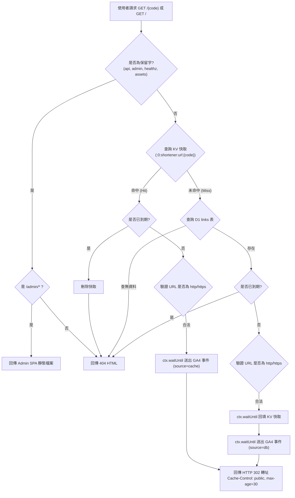

# ZLink 遷移指南與架構重構說明 (Migration Guide)

本文件詳細記錄由既有架構（Django REST Framework + PostgreSQL + Redis + Go ZLinkClient + Angular）全面改寫並整合至單一 Cloudflare Worker（Hono + Workers Static Assets + D1 + KV + Durable Objects）之架構對照、API 規格、資料庫遷移步驟與密碼安全升級機制。

---

## 一、 架構演進概述

| 項目 | 舊架構 | 新架構 (Cloudflare 全端單一 Worker) | 演進效益 |
| :--- | :--- | :--- | :--- |
| **API 後端** | `ZLinkAPI` (Django REST Framework, Python) | `server/` (Hono Worker, TypeScript) | 邊緣執行、冷啟動低於 5ms、無伺服器維護成本 |
| **管理後台前端** | `ZLinkFE` (Angular 20 SPA) | `client/` (Angular 20 SPA 靜態資產，託管於 Workers Static Assets) | 同源邊緣快取提供，免額外 S3/CDN 費用 |
| **轉址服務** | `ZLinkClient` (Go HTTP Server) | `src/routes/redirect.ts` (Worker 熱路徑) | 消除獨立虛擬機器或容器，全球邊緣就近轉址 |
| **關聯式資料庫** | PostgreSQL | Cloudflare D1 (SQLite Dialect via Drizzle ORM) | 免除連線池耗盡風險，邊緣本機低延遲讀取 |
| **轉址快取** | Redis (帶 `:0:shortener:url:{code}` 格式) | Cloudflare KV (相容鍵值格式，TTL 支援) | 全球分散式讀取快取，毫秒級 302 轉址 |
| **限流防護** | Django 限流 | Cloudflare Durable Objects (`RateLimiter`) | 分散式強一致原子計數器，精確固定時間窗口防護 |
| **定期任務** | Celery / Cron | Cloudflare Cron Triggers (`0 3 * * *`) | 原生排程無伺服器觸發清理過期短網址與金鑰 |
| **外部分析** | Go goroutine -> GA4 | Worker `ctx.waitUntil(sendGA4Event)` | 轉址後非同步上報，完全不阻塞使用者 302 回應 |

---

## 二、 前端路由與路徑配置決策

管理介面統一掛載於 `/admin/*`，此設計基於以下技術優勢：
1. **短網址命名空間完全隔離**：
   短網址熱路徑格式為 `GET /{code}` 與根目錄 `GET /`。若將前端放在根目錄，任何前端頁面（如 `/login`, `/dashboard`, `/links`）將與短碼產生衝突。將前端限制於 `/admin/*` 徹底避免保留字污染。
2. **Workers Static Assets 原生支援**：
   Angular 建置設定 `baseHref: "/admin/"`，打包產物置於 `client/dist/browser/admin/`。靜態資產（`.js`, `.css`, i18n `.json`, 圖檔）由 Cloudflare 邊緣直接命中快取回傳（0 Worker CPU 調用），當瀏覽器端路由（SPA pushState）未命中具體檔案時，Worker 後端將請求回退（Fallback）至 `/admin/index.html`。
3. **保留字清單保護**：
   `admin`、`api`、`healthz`、`assets` 等關鍵路徑在建立短網址時列入保留字黑名單，嚴格禁止註冊為短代碼。

---

## 三、 API 端點規格與相容性對照表

本 Worker API 在 `/api/*` 下提供與舊 Django REST Framework 100% 形狀相容之介面，包括查詢參數、回應 JSON 欄位命名（Snake Case）與錯誤結構。

### 1. 短網址管理 (`/api/links/`)

相容於 `ZLinkFE` 與 `ZLinkLineBot`（透過 `X-API-Key`）。

| Django URL (`urls.py`) | Django View / Action | 新 Hono Route | HTTP 方法 | 權限要求 | 說明與相容細節 |
| :--- | :--- | :--- | :--- | :--- | :--- |
| `/api/links/` | `LinkViewSet.list` | `/api/links` | `GET` | Staff 或有效 API Key | 支援 `?search=`, `?ordering=`。回傳純陣列 `Link[]`（符合 DRF 未啟用分頁模式） |
| `/api/links/` | `LinkViewSet.create` | `/api/links` | `POST` | Staff 或有效 API Key | 輸入 `{ original_url, short_code?, expires_at? }`。未填 short_code 則由 Base62 隨機生成；同步清理 KV 快取 |
| `/api/links/{id}/` | `LinkViewSet.retrieve` | `/api/links/:id` | `GET` | Staff 或有效 API Key | 取得單一短網址明細 |
| `/api/links/{id}/` | `LinkViewSet.update` | `/api/links/:id` | `PUT` | Staff 或有效 API Key | 完整更新短網址；異動時使舊短碼之 KV 快取失效 |
| `/api/links/{id}/` | `LinkViewSet.partial_update` | `/api/links/:id` | `PATCH` | Staff 或有效 API Key | 部分更新短網址 |
| `/api/links/{id}/` | `LinkViewSet.destroy` | `/api/links/:id` | `DELETE` | Staff 或有效 API Key | 刪除短網址並非同步清理 KV 快取 |
| `/api/links/expired/` | `LinkViewSet.expired` | `/api/links/expired` | `GET` | Staff | 列出目前所有已過期連結 |
| `/api/links/purge-expired/` | `LinkViewSet.purge_expired` | `/api/links/purge-expired` | `POST` | Staff | 批次清除所有過期連結，回傳 `{ deleted: count }` |
| `/api/links/bulk-delete/` | `LinkViewSet.bulk_delete` | `/api/links/bulk-delete` | `POST` | Staff | 傳入 `{ ids: number[] }` 批次刪除 |

### 2. 身份驗證與 Token 管理 (`/api/auth/`)

| Django URL (`urls.py`) | Django View | 新 Hono Route | HTTP 方法 | 說明與相容細節 |
| :--- | :--- | :--- | :--- | :--- |
| `/api/auth/login/` | `LoginView` | `/api/auth/login` | `POST` | 驗證帳密。成功時回傳 `{ access, refresh, user }` 並寫入雙安全 Cookie（`__Host-zl_at`, `__Secure-zl_rt`）。若檢測為舊版 Django PBKDF2 密碼，自動無感升級為 100,000 次雜湊 |
| `/api/auth/refresh/` | `TokenRefreshView` | `/api/auth/refresh`, `/api/auth/token/refresh` | `POST` | 支援請求體 `{ refresh: "..." }` 或 Strict Cookie；執行 Refresh Token Rotation，舊 Token 立即吊銷黑名單 |
| `/api/auth/logout/` | `LogoutView` | `/api/auth/logout` | `POST` | 吊銷 Refresh Token、清除 Session Cookies |
| `/api/auth/me/` | `MeView` | `/api/auth/me` | `GET` | 取得當前已登入使用者資料 |
| `/api/auth/passkeys/` | `PasskeyViewSet.list` | `/api/auth/passkeys` | `GET` | 列出已註冊之 Passkey 清單 |
| `/api/auth/passkeys/{id}/` | `PasskeyViewSet.partial_update` | `/api/auth/passkeys/:id` | `PATCH` | 更新 Passkey 名稱（`{ name: "..." }`） |
| `/api/auth/passkeys/{id}/` | `PasskeyViewSet.destroy` | `/api/auth/passkeys/:id` | `DELETE` | 刪除指定 Passkey |
| `/api/auth/passkeys/register/options/` | `PasskeyRegisterOptionsView` | `/api/auth/passkeys/register/options` | `POST` | 產生 WebAuthn 註冊挑戰碼，以 HMAC-SHA256 JWT `state` 傳遞（5分鐘時效，無伺服器狀態依賴） |
| `/api/auth/passkeys/register/verify/` | `PasskeyRegisterVerifyView` | `/api/auth/passkeys/register/verify` | `POST` | 驗證 WebAuthn 註冊回應並持久化儲存公開金鑰 |
| `/api/auth/passkeys/login/options/` | `PasskeyLoginOptionsView` | `/api/auth/passkeys/login/options` | `POST` | 產生 WebAuthn 免密登入挑戰碼 |
| `/api/auth/passkeys/login/verify/` | `PasskeyLoginVerifyView` | `/api/auth/passkeys/login/verify` | `POST` | 驗證 WebAuthn 簽章，簽發 Access/Refresh Token |

### 3. 使用者與角色管理 (`/api/users/`)

| Django URL (`urls.py`) | Django View | 新 Hono Route | HTTP 方法 | 權限要求 | 說明與相容細節 |
| :--- | :--- | :--- | :--- | :--- | :--- |
| `/api/users/` | `UserViewSet.list` | `/api/users` | `GET` | Superuser | 列出所有帳號 |
| `/api/users/` | `UserViewSet.create` | `/api/users` | `POST` | Superuser | 建立新管理者，預設為 Staff 角色 |
| `/api/users/{id}/` | `UserViewSet.retrieve` | `/api/users/:id` | `GET` | Superuser | 取得指定使用者資訊 |
| `/api/users/{id}/` | `UserViewSet.partial_update` | `/api/users/:id` | `PATCH` | Superuser | 更新使用者資料或重設密碼 |
| `/api/users/{id}/` | `UserViewSet.destroy` | `/api/users/:id` | `DELETE` | Superuser | 禁止刪除自己 |
| `/api/users/stats/` | `UserViewSet.stats` | `/api/users/stats` | `GET` | Superuser | 回傳 `{ total, active, superusers }` |
| `/api/users/{id}/toggle-active/` | `UserViewSet.toggle_active` | `/api/users/:id/toggle-active` | `POST` | Superuser | 切換啟用狀態（禁止停用自己或唯一超級管理員） |

### 4. API 金鑰管理 (`/api/api-keys/`)

| Django URL (`urls.py`) | Django View | 新 Hono Route | HTTP 方法 | 權限要求 | 說明與相容細節 |
| :--- | :--- | :--- | :--- | :--- | :--- |
| `/api/api-keys/` | `ApiKeyViewSet.list` | `/api/api-keys` | `GET` | Staff | 列出目前帳號所持金鑰前綴與狀態（不含明文金鑰） |
| `/api/api-keys/` | `ApiKeyViewSet.create` | `/api/api-keys` | `POST` | Staff | 產生新金鑰（`zlk_` 開頭），僅於建立當下回傳明文 `{ key: "..." }` |
| `/api/api-keys/{id}/` | `ApiKeyViewSet.partial_update` | `/api/api-keys/:id` | `PATCH` | Staff | 停用或啟用金鑰（`{ is_active: false }`） |
| `/api/api-keys/{id}/` | `ApiKeyViewSet.destroy` | `/api/api-keys/:id` | `DELETE` | Staff | 刪除金鑰 |
| `/api/api-keys/expired/` | `ApiKeyViewSet.expired` | `/api/api-keys/expired` | `GET` | Staff | 列出過期金鑰 |
| `/api/api-keys/purge-expired/` | `ApiKeyViewSet.purge_expired` | `/api/api-keys/purge-expired` | `POST` | Staff | 清理過期金鑰 |

### 5. 個人設定與快取維護

| Django URL (`urls.py`) | 新 Hono Route | HTTP 方法 | 權限要求 | 說明 |
| :--- | :--- | :--- | :--- | :--- |
| `/api/profile/` | `/api/profile` | `GET` / `PATCH` | 已登入 | 讀取或更新個人資料（支援修改密碼、頭像、關閉密碼登入開關；若無註冊 Passkey 則禁止關閉密碼登入） |
| `/api/cache/keys/` | `/api/cache/keys` | `GET` / `DELETE` | Superuser | 檢視或依 pattern 刪除 KV 短網址快取 |
| `/api/cache/clear/` | `/api/cache/clear` | `POST` | Superuser | 清空所有短網址快取 |
| `/api/healthz/` | `/healthz`, `/api/healthz` | `GET` | 公開 | 系統健康狀態回報 `{ status: "ok" }` |
| `/api/schema/`, `/api/docs/` | `/api/schema`, `/api/docs` | `GET` | 公開 | 提供 OpenAPI 3.0 JSON 規格文件與 Swagger UI 互動頁面 |

---

## 四、 資料結構與 JSON 相容保證

所有 API 序列化皆維持 Django REST Framework 既定規格：
1. **列表端點均回傳陣列**：
   `/api/links/`、`/api/users/`、`/api/api-keys/`、`/api/auth/passkeys/` 皆直接以 JSON 陣列 `[...]` 回傳，不包裝額外分頁容器，完全符合 Angular 前端與 LineBot 用戶端期待。
2. **錯誤結構相容**：
   - 通用錯誤：`{ "detail": "錯誤說明文字" }`
   - 欄位校驗錯誤：`{ "fieldname": ["此欄位為必填。"] }`
   - 統一由 `src/middleware/error.ts` 與 `src/lib/http.ts` 集中格式化，生產環境不洩漏資料庫或伺服器堆疊追蹤。

---

## 五、 密碼雜湊遷移與無感升級 (Zero-Downtime Password Upgrade)

### 1. 舊版 Django 雜湊格式
舊 Django API 採用 PBKDF2-SHA256：
```text
pbkdf2_sha256$<iterations>$<salt>$<base64_hash>
```
例如：`pbkdf2_sha256$260000$abc123...$xyz789...`

### 2. 新版 Worker 雜湊標準
Worker 採用 Web Crypto API 原生 `crypto.subtle.deriveBits`，同樣相容 PBKDF2-SHA256 格式，並以 100,000 次疊代為現代標準安全設定。

### 3. 升級驗證邏輯（實作於 `src/lib/crypto.ts`）
- **登入時**：`verifyPassword(password, hash)` 解析字串前綴與疊代次數。若比對舊雜湊成功，接著執行 `needsRehash(user.passwordHash)`。
- **無感升級**：若發現疊代次數不等於 100,000 或格式不同，立即以使用者輸入的明文密碼重新計算標準雜湊，並更新寫入 D1 資料庫。既有使用者無需強制重設密碼。

### 4. Django 6 高疊代雜湊 (1.2M PBKDF2) 與 CPU 方案要求
- **1.2M 次 PBKDF2 運算負擔**：Django 6 預設密碼雜湊採用 1,200,000 (1.2M) 次 PBKDF2-SHA256 疊代（格式如 `pbkdf2_sha256$1200000$<salt>$<hash>`）。在 Cloudflare Workers 邊緣環境中，驗證此類高疊代雜湊需要約 80~150ms 之 CPU 時間。
- **方案限制與付費需求**：Cloudflare Workers 免費方案 (Free Plan) 限制單次請求 CPU 時間為 10ms（突發上限 50ms），直接執行 1.2M 次雜湊驗證會觸發 `CPU time limit exceeded` 錯誤。因此在含有 Django 6 舊雜湊帳號遷移上線時，**必須採用 Cloudflare Workers 付費方案 (Workers Paid / Standard usage model)**，該方案提供高達 30 秒的 CPU 時間上限。
- **首次登入後自動降載**：一旦使用者完成首次登入驗證，系統會即刻將其密碼無感升級為 100,000 次疊代（耗時小於 10ms），後續所有登入將以低 CPU 時間執行，大幅節省邊緣運算資源並提升回應速率。

---

## 六、 既有資料庫遷移步驟 (PostgreSQL -> Cloudflare D1)

> [!IMPORTANT]
> 進行資料遷移時，不得在正式環境執行未經轉換的原始 SQL，請遵循以下離線匯出與轉換流程。

### 步驟 1：離線匯出 PostgreSQL 資料
在舊資料庫伺服器上執行 `pg_dump`，僅匯出資料（以 INSERT 格式匯出，並指定欄位名稱）：
```bash
pg_dump -U <username> -d <database_name> \
  --data-only \
  --inserts \
  --column-inserts \
  -t auth_user \
  -t shortener_profile \
  -t shortener_link \
  -t shortener_apikey \
  -t shortener_passkey \
  > postgres_dump.sql
```

### 步驟 2：執行轉換腳本
使用專案提供的轉換腳本 `server/scripts/migrate-postgres-to-d1.ts`：
```bash
cd server
node --experimental-strip-types scripts/migrate-postgres-to-d1.ts postgres_dump.sql > d1_seed.sql
```
該腳本會執行：
1. 資料表名稱自動映射：`auth_user` -> `users`、`shortener_profile` -> `profiles`、`shortener_link` -> `links`、`shortener_apikey` -> `api_keys`、`shortener_passkey` -> `passkeys`。
2. 布林值轉換：PostgreSQL 之 `true` / `false` 轉為 SQLite 之整數 `1` / `0`。

### 步驟 3：本機驗證與匯入 D1
1. 建立本機資料庫 Schema：
   ```bash
   wrangler d1 migrations apply zlink --local
   ```
2. 匯入轉換後的資料：
   ```bash
   wrangler d1 execute zlink --local --file=d1_seed.sql
   ```
3. 正式部署時（待團隊正式上線審核後）：
   ```bash
   wrangler d1 execute zlink --remote --file=d1_seed.sql
   ```

---

## 七、 轉址熱路徑、KV 快取與 GA4 非同步追蹤

### 1. 轉址流向


### 2. 快取鍵與過期設計
- **鍵格式**：`:0:shortener:url:{short_code}`（相容舊 Redis 鍵名格式）。
- **TTL 機制**：
  - 若連結設有 `expires_at`，KV 快取存活時間設為該過期時間；到期後自動失效。
  - 若為無期限短網址，KV 鍵值永久保存，直至管理介面修改或刪除時被即時剔除。
- **瀏覽器快取**：
  - 302 轉址帶有標頭 `Cache-Control: public, max-age=30, s-maxage=30`，兼顧瀏覽器效能與短網址即時下線管理。
